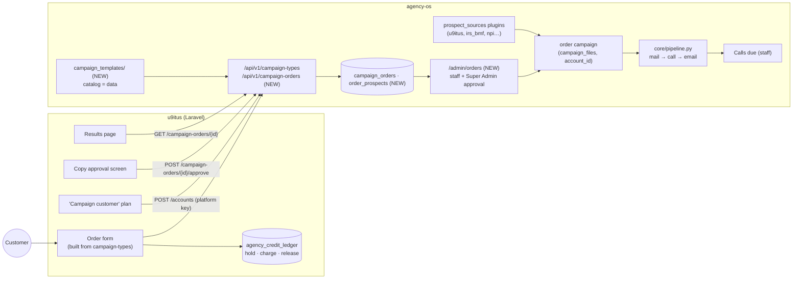

# Campaign orders: u9itus sells, agency-os runs

Spec for letting a **u9itus** customer (`/Volumes/PRO-BLADE/Github/u9itus.dev`,
Laravel) order a **hybrid campaign** that agency-os staff run for them: AI
drafts, a postcard goes out through Lob, a person calls once it lands, and email
follows. Written for a coding agent, in the same format as
[U9ITUS_BILLING.md](U9ITUS_BILLING.md): diagrams are Mermaid, the contract is
YAML, and tasks have file paths and acceptance checks.

Status (2026-10-11): **proposed.** Nothing is built. It builds on the paid
search work (accounts, keys, u9itus billing; [U9ITUS_BILLING.md](U9ITUS_BILLING.md))
and on the mail→call cadence ([MAILER_FOLLOWUP_CALLS.md](MAILER_FOLLOWUP_CALLS.md)
M1–M5, branch `feat/u9itus-hybrid-campaign`). Open questions for the owner are
in section 9.

## Decisions already made (owner, 2026-10-11)

| # | Decision |
|---|---|
| D1 | **Priced per campaign.** A customer buys a campaign type at a fixed price, not per touch. |
| D2 | **Leads come from agency-os's own sources** (prospect source plugins, house prospects), not from the customer's searches. The customer gets **results, never the list**. |
| D3 | **Outreach goes out "on behalf of" the customer**: their name first, u9itus named as the sender, never sent from the customer's own domain (section 6). |
| D4 | **This is a core feature in both apps**, not a plugin. Only the catalog of campaign types is data (section 3). |

## Goal

A u9itus customer, say a bakery, picks "Neighborhood launch: 250 local
businesses", fills in their offer and area, approves the copy, and pays. Over the
next few weeks 250 nearby businesses get a postcard, a call from a person and a
follow-up email that say who they're from. The customer watches progress in
u9itus and receives the contacts who said yes. agency-os never hands over the
rest of the list.

## Constraints that shape the design

| Fact | Consequence |
|---|---|
| u9itus already sells plans, holds credits and creates agency-os accounts with its platform key; customers never sign in to agency-os | **u9itus does the ordering UI and billing.** agency-os adds API endpoints for the account key. No customer logins in agency-os. |
| Leads are house prospects (D2) | Staff already see them, so **no tenancy exception** is needed. But two customers, or a customer and a house campaign, could now reach the same business, so prospects must be **locked to one order** and **capped** across all campaigns (section 5). |
| House leads are also sold as lead packages (`published_packages`, `published_leads`) and to recruiters | A lead in an active published package is never put in an order. |
| Campaigns are YAML stored in `campaign_files` and loaded through `get_campaigns()` | An order **instantiates** a campaign from a template: it writes new campaign files and invalidates the campaign cache, like `/admin/campaigns/create` does. |
| Lob costs money per piece on one shared Lob account; turning Lob on is Super Admin only | Every order needs a **Super Admin approval** before its first mailer. Sends stay deliberate `enqueue` runs. |
| `AGENCY_OS_POSTAL_ADDRESS`, `SMTP_FROM` and `LOB_FROM_*` are global | The sender identity per order (D3) needs the email footer, From name, Reply-To and Lob return address to come from the order. |
| Only people place calls ([BROWSER_CALLING.md](BROWSER_CALLING.md)) | The call step stays a Calls due task for staff. AI drafts and preps only. |

## 1. System map



## 2. Lifecycle (one order)

```mermaid
sequenceDiagram
  autonumber
  participant C as Customer
  participant U as u9itus
  participant A as agency-os
  participant S as Staff (agency-os)

  C->>U: picks a campaign type, fills the form
  U->>U: hold the campaign price (ledger: hold)
  U->>A: POST /campaign-orders {type, params, idempotency_key}
  A-->>U: 202 {order: {status: drafting}}
  A->>A: AI drafts the copy from the template + params
  A->>A: status: staff_review
  S->>A: edits/approves copy; Super Admin approves Lob spend
  A->>A: status: customer_review
  U->>A: GET /campaign-orders/{id} (polls)
  U-->>C: shows the drafted postcard, email and call script
  C->>U: approves (or asks for changes)
  U->>A: POST /campaign-orders/{id}/approve
  A->>A: create the campaign, pick and lock leads, status: running
  Note over A,S: postcard → call when it lands → email (MAILER_FOLLOWUP_CALLS.md)
  S->>A: works Calls due, logs calls, marks "OK to pass on"
  U->>A: GET /campaign-orders/{id} (report)
  A-->>U: status: done, delivered counts, handoffs
  U->>U: charge per the guarantee, release the rest
```

A customer who asks for changes sends `POST /campaign-orders/{id}/changes
{note}`, which moves the order back to `staff_review`. A customer can cancel
before `running` for a full release. After that, cancel stops new touches and
settles on what was delivered.

## 3. The catalog (data, not code)

A campaign type is a folder in `campaign_templates/` (not `campaigns/`, so a
template never runs as a house campaign): a `campaign.yaml` with `{{param}}`
placeholders, its `scripts/`, and an `order.yaml` that describes the product.
Adding a type needs no code in either app, the same way a search plugin's
`fields` drive u9itus's search form.

```yaml
# campaign_templates/neighborhood-launch/order.yaml
key: neighborhood-launch
label: "Neighborhood launch"
description: "Introduce your business to up to 250 local businesses: a postcard, a call from our team when it lands, and a follow-up email."
price_cents: 150000
max_prospects: 250
guarantee: pieces_mailed            # what the price promises (section 7)
fields:                             # what the customer fills in; served to u9itus as-is
  - {name: offer, label: "What you're offering", type: textarea, required: true, max: 300}
  - {name: city, label: City, type: text, required: true, example: "Long Beach"}
  - {name: state, label: State, type: state, required: true}
  - {name: audience, label: "Who to reach", type: choice, required: true,
     choices: [restaurants, retail, offices, nonprofits]}
lead_sources: [u9itus, irs_bmf]     # prospect source plugins this type may draw from
audience_filters:                   # maps each audience choice to source filters
  restaurants: {u9itus_kinds: [business], u9itus_categories: [restaurant, cafe]}
  nonprofits:  {u9itus_kinds: [organization]}
```

## 4. Contract (machine-readable)

```yaml
base_url: ${AGENCY_OS_BASE_URL}
auth:
  account: "Authorization: Bearer aos_acct_…"   # the existing per-customer key
errors: {401: unauthorized, 403: account_suspended, 404: not_found,
         409: conflict, 422: invalid, 503: service_not_configured}

endpoints:
  - GET /api/v1/campaign-types
    response: {types: [{key, label, description, price_cents, max_prospects, guarantee, fields}]}

  - POST /api/v1/campaign-orders
    body:
      type: neighborhood-launch
      idempotency_key: "u9-order-8812"          # u9itus's id; a retry never makes a second order
      params: {offer: "…", city: "Long Beach", state: CA, audience: restaurants}
      sender:                                   # who the outreach is on behalf of (section 6)
        business_name: "Sunrise Bakery"
        contact_name: "Maria Lopez"
        reply_to: "maria@sunrise.example"
        postal_address: {line1: "1 Pine Ave", city: "Long Beach", state: CA, zip: "90802"}
        phone: "+15625550100"                   # optional; given to people who ask on a call
    response_202: {order: <order>}
    409: same idempotency_key with different settings

  - GET /api/v1/campaign-orders/{id}
    response_200: {order: <order>}

  - POST /api/v1/campaign-orders/{id}/approve      # only in customer_review
  - POST /api/v1/campaign-orders/{id}/changes      # {note}; only in customer_review
  - POST /api/v1/campaign-orders/{id}/cancel

order:
  id: 41
  type: neighborhood-launch
  status: drafting | staff_review | customer_review | running | done | canceled | failed
  created_at: …
  copy:                                 # present from customer_review on
    postcard: {front: "…", back: "…"}
    emails: [{subject: "…", body: "…"}]
    call_script: "…"
  progress:
    prospects: 250                      # locked to this order
    pieces_mailed: 212
    pieces_delivered: 180
    calls_logged: 96
    conversations: 31                   # outcome completed / gatekeeper / scheduled
    emails_sent: 140
  handoffs:                             # only contacts a caller marked "OK to pass on"
    - {business: "Harbor Dental", contact: "Dr. Kim", phone: "+1…", email: "…",
       note: "Wants 20 boxes for staff day", logged_at: …}
  settlement:                           # present once done or canceled
    guarantee: pieces_mailed
    promised: 250
    delivered: 212
    charge_cents: 127200                # price × delivered / promised (section 7)
```

## 5. Lead rules

Picking leads happens when the order moves to `running`. Every rule is checked
in one query, so a lead is never in two places at once:

| Rule | How |
|---|---|
| Matches the order | The type's `lead_sources`, synced with `audience_filters` plus the customer's city and state. |
| One active order per prospect | `order_prospects(order_id, prospect_id)` with a unique index on `prospect_id` for orders not `done` or `canceled`. |
| Contact cap across everything | Leave out prospects reached in **any** campaign, house or order, in the last `AGENCY_OS_ORDER_COOLDOWN_DAYS` (default 90): `email_log` sends, `call_log` calls. |
| Not sold elsewhere | Leave out prospects in an active `published_packages` (`published_leads`) and in recruiting campaigns (`requires_permission`). |
| Respect opt-outs | Leave out `do_not_call` prospects for call steps, `email_suppressions` for email, and returned mail for mail. Opt-outs are global: unsubscribing from one customer's campaign suppresses that address everywhere. |
| Never a customer's own prospect | Leave out prospects with `account_id` (found by a customer's search). |

If fewer than `max_prospects` pass, the order still runs with what passed. The
guarantee settles on what was delivered.

## 6. Sender identity ("on behalf of")

| Channel | What the recipient sees |
|---|---|
| Postcard | The customer's name and offer on the front. The **customer's postal address** as the return address. Small print: "Sent for Sunrise Bakery by u9itus." |
| Email | `From: Sunrise Bakery via u9itus <campaigns@mail.u9itus.com>`, `Reply-To:` the customer. The footer has the customer's postal address and a u9itus unsubscribe link. |
| Call | "Hi, this is Josh with u9itus, calling on behalf of Sunrise Bakery…" A person reads it from the call script. |

Rules:
- Never send as the customer from their own domain (it fails SPF/DMARC, and it's impersonation).
- CAN-SPAM's "sender" is the business being advertised, so the customer's postal
  address goes in the footer and on the postcard.
- Replies go to the customer. agency-os tracks only unsubscribes and bounces.
- Counsel reviews the disclosure wording and the customer terms before the first
  paid order (Q1).

## 7. Billing (per campaign)

u9itus holds the full price when the order is placed. On `done` or `canceled`,
agency-os reports a `settlement`; u9itus charges `charge_cents` and releases the
rest. The default guarantee is **pieces mailed**: the price assumes
`max_prospects` postcards, and fewer mailed (not enough leads passed section 5,
or a cancel) means a pro-rata charge. Canceled before `running`: no charge.
Outcomes (conversations, handoffs) are reported but never promised.

agency-os keeps its own cost per order (Lob pieces, enrichment) in
`campaign_orders` so a Super Admin can see margin. That is never sent to u9itus.

## 8. Tasks

### agency-os

| ID | Task | Files | Acceptance check |
|---|---|---|---|
| O1 | Catalog: load `campaign_templates/*/order.yaml`; validate fields, price, guarantee, sources; serve `GET /api/v1/campaign-types` | `core/orders.py` (NEW), `web/app.py`, `campaign_templates/neighborhood-launch/` | A malformed template is skipped with a log line; the endpoint lists only valid types; a template never appears in `get_campaigns()`. |
| O2 | Orders: `campaign_orders` table; create (idempotent on `account_id, idempotency_key`), get, approve, changes, cancel; status transitions enforced | `core/db.py`, `core/orders.py`, `web/app.py`, `core/access.py` | A retry returns the same order; reusing a key with other params is 409; approve outside `customer_review` is 409; a suspended account gets 403. |
| O3 | Drafting: fill the template's scripts from params and the sender, have the app's model draft the offer copy, store it on the order, move to `staff_review` | `core/orders.py`, `core/llm.py` (existing) | With AI off (`AGENCY_OS_AI=off`) the order still drafts from the template text alone. Customer params are passed to the model as data. |
| O4 | Staff review page: list orders by status; edit copy; approve (`orders.review`); Lob spend approval Super Admin only | `web/app.py`, `web/templates/admin_orders.html`, `core/access.py` (`orders.review`) | A Sales Rep without `orders.review` gets 403; an Owner can approve copy but not Lob spend; approval moves the order to `customer_review`. |
| O5 | Launch: on customer approve, write the campaign files (`orders/<id>/…`) with `account_id`, invalidate the campaign cache, sync the type's sources, pick leads under section 5's rules, add assigned callers as campaign members | `core/orders.py`, `core/db.py` (`order_prospects`, `campaigns.account_id`), `core/campaign.py` | Tests: a prospect locked to one running order is never picked by a second; one contacted 30 days ago in a house campaign is skipped; one in an active published package is skipped. |
| O6 | Sender identity: per-campaign `sender:` block used for the email From name, Reply-To and footer postal address, and the Lob return address | `core/campaign.py`, `core/compliance.py`, `plugins/channels/email_smtp.py`, `plugins/channels/lob_direct_mail.py` | An order email has `From: X via u9itus`, the customer's Reply-To and postal address; house campaigns are unchanged. |
| O7 | Handoffs: an "OK to pass on to the customer" checkbox on the call log form (Calls due and prospect page); only those contacts appear in `handoffs` | `core/db.py` (`call_log.handoff_ok`), `web/templates/calls_due.html`, `web/templates/prospect_detail.html` | The report lists only checked contacts and never the rest of the order's prospects. |
| O8 | Report and settlement: progress counts from `email_log`, `contact_events`, `call_log`; `done` when the cadence is exhausted for every locked prospect; settlement per the guarantee | `core/orders.py` | Counts match the logs; a canceled running order settles on pieces mailed so far. |
| O9 | Order job: advance drafting, check for done, release locks of finished orders (idempotent, never sends) | `core/jobs.py` | Running it twice changes nothing the second time. |

### u9itus

| ID | Task | Files | Acceptance check |
|---|---|---|---|
| U1 | "Campaign customer" plan: on subscribe, create the agency-os account (existing `POST /api/v1/accounts`) and store its key encrypted | billing / plan code | A retried subscription never makes a second account. |
| U2 | Order form built from `GET /campaign-types`; holds the price in `agency_credit_ledger`; `POST /campaign-orders` from a queued job | controller, Vue page, job | Refused when credits are short; a retried job reuses the idempotency key. |
| U3 | Copy approval screen: shows postcard, emails and call script; approve or request changes | controller, Vue page | Approve and changes call the matching endpoints; the screen is read-only outside `customer_review`. |
| U4 | Results page: progress and handoffs, polled from `GET /campaign-orders/{id}` | controller, Vue page | Never shows anything beyond the order payload. |
| U5 | Settlement: on `done` or `canceled`, charge `charge_cents`, release the rest | ledger code | One charge per order, even when polled repeatedly. |
| U6 | Customer terms: agreement to on-behalf-of outreach, shown at first order | terms page, order form | An order can't be placed without accepting the current terms version. |

Suggested order: O1 → O2 → O3 → O4 → O6 → O5 → O7 → O8 → O9, with U1–U6 alongside
from O2 on.

## 9. Open questions (owner)

1. **Counsel:** review the disclosure wording (section 6) and customer terms (U6) before the first paid order.
2. **Approval order:** staff review before the customer sees the copy (as specced), or customer first?
3. **Cooldown:** is 90 days between campaigns for one prospect right, and does it count house campaigns (as specced)?
4. **Guarantee:** pieces mailed (as specced), or pieces delivered (Lob delivery scans aren't guaranteed)?
5. **Sending domain:** set up `mail.u9itus.com` (SPF, DKIM, DMARC) for order email, separate from the house sending domain, so one customer's campaign can't hurt house deliverability.
6. **Lob account:** keep the one shared Lob account (Super Admin approval per order), or a separate Lob account for orders?
7. **Exclusivity:** may two customers in the same city order the same audience at the same time? With the per-prospect lock, the second gets only what's left.

## 10. Guardrails

- **Customers get results, never the list.** Only handoffs a caller marked OK leave agency-os.
- **Nothing sends without people.** Copy is approved by staff and the customer, Lob spend by a Super Admin, sends run on a deliberate `enqueue`, and calls are made by people.
- **One business, one campaign at a time,** with a cooldown across every campaign.
- **Opt-outs are global.**
- **Customer input is data.** The offer text goes to the model as data it must not take instructions from, like prospect records today.
- **Honest sender.** Every channel says it's u9itus on behalf of the customer.

